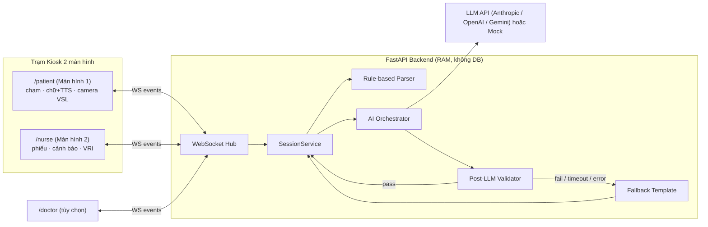
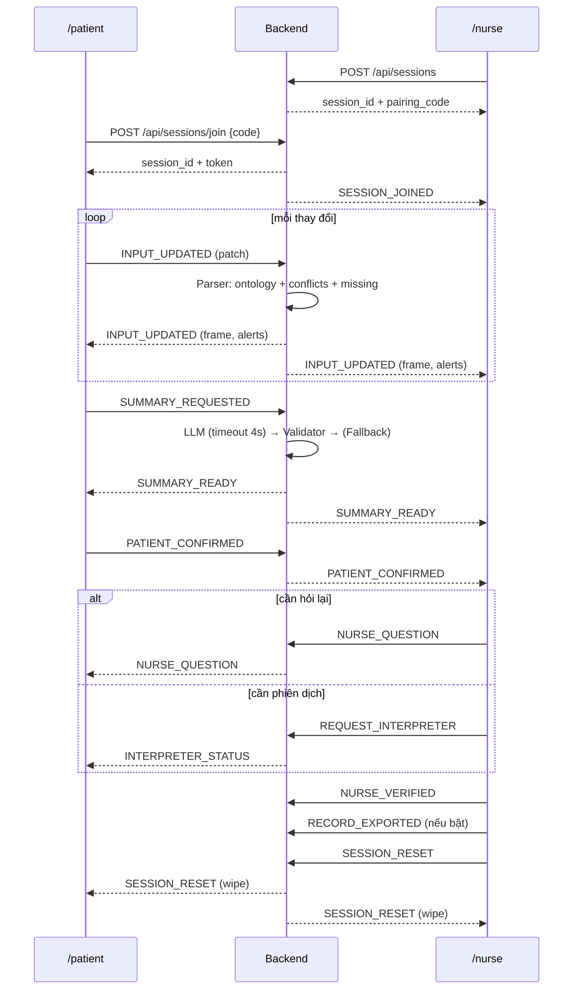

# 08 — ARCHITECTURE

## 1. Tổng quan


## 2. Luồng chính (sequence)


## 3. Clean Architecture — Backend
Phụ thuộc chỉ đi **vào trong**: `api → application → domain`; `infrastructure` và `ai` cắm vào qua interface (Protocol) do `application`/`domain` định nghĩa.
```
backend/
├── app/
│   ├── main.py                    # tạo FastAPI app, include routers, CORS
│   ├── config.py                  # Settings (pydantic-settings): ENV, LLM_PROVIDER, LLM_TIMEOUT_S, ...
│   ├── api/
│   │   ├── rest/                  # sessions.py, health.py, ontology.py, dev.py
│   │   └── ws/                    # hub.py (kết nối/phòng), handlers.py (event → use case), envelope.py
│   ├── application/               # use cases, không biết FastAPI
│   │   ├── session_service.py     # tạo/ghép/xóa phiên, state machine
│   │   ├── input_service.py       # INPUT_UPDATED → merge → parser
│   │   ├── summary_service.py     # gọi orchestrator, tạo TriageSummary
│   │   └── ports.py               # Protocol: SessionStore, LLMClient, Clock
│   ├── domain/                    # thuần Python, không I/O
│   │   ├── models.py              # SemanticFrame, TriageSummary, Alert (Pydantic v2)
│   │   ├── events.py              # Envelope + payload models cho từng event
│   │   ├── parser.py              # Rule-based Semantic Parser
│   │   ├── rules_config.py        # ngưỡng, red-flag, từ khóa
│   │   ├── state_machine.py
│   │   └── ontology/              # *.json + loader.py
│   ├── ai/                        # AI orchestration
│   │   ├── orchestrator.py        # build prompt → LLM (timeout) → validator → fallback
│   │   ├── prompts/               # summary_system_vi.txt
│   │   ├── validator.py           # V1..V8
│   │   ├── fallback_template.py
│   │   └── redaction.py           # che định danh trước khi gửi LLM
│   └── infrastructure/
│       ├── session_store_memory.py
│       └── llm/                   # base.py, mock.py, anthropic_client.py, openai_client.py, gemini_client.py
├── tests/
│   ├── unit/                      # parser, state machine, redaction
│   ├── safety/                    # validator: bộ câu độc hại + hợp lệ
│   ├── integration/               # WebSocket end-to-end bằng TestClient
│   └── contract/                  # schema ⇄ TypeScript
├── pyproject.toml
└── .env.example
```

## 4. Clean Architecture — Frontend
```
frontend/
├── src/
│   ├── main.tsx, App.tsx, routes.tsx
│   ├── types/                     # frame.ts, events.ts, summary.ts (khớp Pydantic)
│   ├── services/                  # không chứa UI
│   │   ├── ws/                    # socketClient.ts (reconnect, seq, heartbeat)
│   │   ├── api/                   # rest.ts
│   │   ├── tts/                   # speak.ts (speechSynthesis + chọn giọng vi-VN)
│   │   ├── vsl/                   # GlossRecognizer.ts (interface), MockRecognizer.ts, MediaPipeRecognizer.ts
│   │   └── storage/               # sessionStore.ts (CHỈ sessionStorage) + wipe()
│   ├── hooks/                     # useSessionSocket, useWizard, useTTS, useIdleReset, useCamera
│   ├── state/                     # wizardReducer.ts, nurseReducer.ts, SessionContext.tsx
│   ├── features/
│   │   ├── patient/               # PatientPage, steps/{ChooseMode,Symptoms,Allergy,Confirm}, BodyMap, PainSlider
│   │   ├── nurse/                 # NursePage, SummaryBoard, ConfirmedPanel, AlertsPanel, QuestionPicker, ExportButton
│   │   └── doctor/                # (tùy chọn)
│   ├── ui/                        # Button, BigIconButton, Card, Badge, Modal, StatusBar (design system)
│   ├── i18n/                      # vi.ts (toàn bộ chuỗi UI)
│   ├── styles/                    # tailwind.css, tokens
│   └── mocks/                     # fixtures cho demo + test
├── tests/ (vitest) + e2e/ (playwright)
└── vite.config.ts, tailwind.config.ts, tsconfig.json
```
Quy tắc phụ thuộc: `features → hooks/ui/state → services → types`. `services` không import React. `ui` không biết nghiệp vụ.

## 5. Chế độ chạy
| `ENV` | LLM | VSL | Dữ liệu | Ghi chú |
|---|---|---|---|---|
| `dev` | live nếu có key, nếu không mock | mock | trống | |
| `demo` | **mock có kịch bản** + nút ép Fallback | mock (nút giả lập gloss) | kịch bản mẫu | Dùng khi trình diễn, chạy được **offline** |
| `prod` | live | thật | trống | Ngoài phạm vi MVP |

## 6. Phi chức năng
- Độ trễ: `INPUT_UPDATED` → broadcast < 200 ms (mạng LAN). Tóm tắt LLM tối đa 4 s rồi Fallback.
- Độ tin cậy: WS tự reconnect (backoff 0.5 s → 5 s); phát lại theo `seq`.
- Offline demo: không phụ thuộc CDN (font self-host, icon bundle); LLM mock mặc định khi mất mạng.
- Kiosk: khóa zoom/scroll ngoài ý muốn; `touch-action` tối ưu; hỗ trợ màn hình 10–15 inch (1280×800 trở lên) và dọc/ngang.
