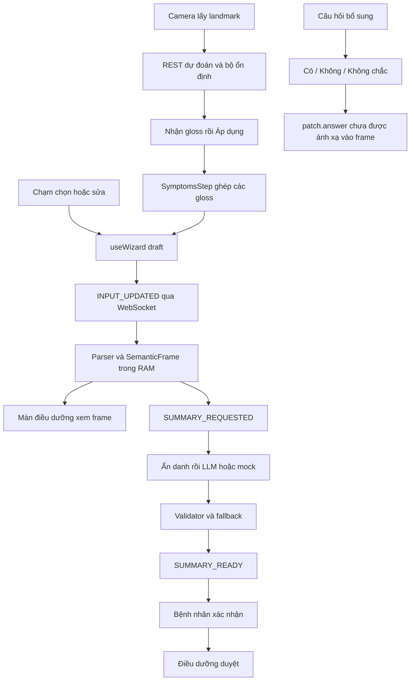
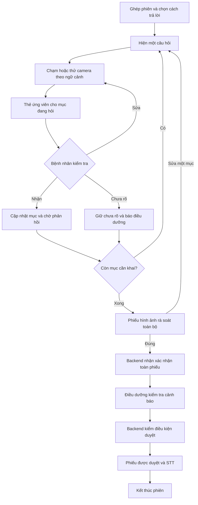

# Gói A — Kiểm kê và phạm vi đề xuất để duyệt

Ngày kiểm tra 19/11/2026. Mốc mã nguồn eaa37e7. Đầu ra gồm kiểm kê, thiết kế luồng, tác vụ và đề xuất cần chốt cho Gói B.

## 1. Điều kiện chủ dự án vừa xác nhận

- Thời gian gấp, ngày thi cụ thể còn chưa được cung cấp. Thứ tự bên dưới ưu tiên theo mức ảnh hưởng.
- Hiện chỉ có người thử nội bộ.
- Chưa có video/landmark VSL kèm quyền sử dụng và thông tin chia theo người ký ngoài những gì đang có trong repo.
- Luồng thi chính Chạm + LLM mock và camera tùy chọn tiếp tục theo D-017. D-018/Q-16 đã chốt tọa độ bàn tay gửi backend LAN.

Đề xuất chọn B0 và B1 dưới đây. Thời gian ước lượng B0 khoảng nửa đến một ngày, B1 khoảng một đến hai ngày tùy kết quả hồi quy. Mốc này là ước lượng công việc sau duyệt.

## 2. Bằng chứng kiểm tra

make check đã qua với 79 test backend, 68 test frontend. Có warning hiện hữu từ dependency/backend và React/jsdom. Bộ test xanh xác nhận phạm vi đã phủ, các lỗi mới dưới đây cần ca hồi quy bổ sung khi triển khai.

Đã chạy một script Python gọi trực tiếp handle_ws_message, parser và bộ dựng tóm tắt trong tiến trình riêng, cùng script Node thực thi chính hàm handleApplyVSLGlosses được trích từ SymptomsStep.tsx và chuyển TypeScript sang JavaScript. Dữ liệu đều giả lập. Đây là tái hiện ở cấp handler/hàm xử lý, chưa có đợt đo người dùng hay đánh giá camera mới.

Các script tạm của phiên làm việc nằm tại /tmp/signly-audit-a.py và /tmp/signly-audit-a.cjs, kết quả tại /tmp/signly-audit-a-results.txt. Bảng dưới ghi đủ đầu vào, trình tự và kết quả để chuyển thành test hồi quy trong repo.

| ID, ưu tiên | Loại và ca tái hiện | Kết quả quan sát | Vị trí và hệ quả |
|---|---|---|---|
| A01, P0 | Lỗi backend. Tạo phiếu có EMERGENCY_RED_FLAG, bệnh nhân xác nhận, gửi NURSE_VERIFIED với acknowledged_alerts rỗng | status trở thành nurse_verified | backend/app/api/ws/handlers.py, nhánh NURSE_VERIFIED chỉ kiểm trạng thái. NursePage khóa bằng UI nhưng backend chưa kiểm critical ack. Cần phủ chất lượng và safety |
| A02, P0 | Lỗi nhất quán. Sau duyệt phiếu mức đau 3, gửi INPUT_UPDATED mức đau 9 | status vẫn nurse_verified, frame có 9 còn summary có 3 | handlers.py và state_machine.py cho sửa frame trước kiểm trạng thái. UI có thể tiếp tục xem phiếu đã duyệt trong khi dữ liệu đổi |
| A03, P1 | Lỗi hai chiều. Gửi ASK_DRUG_ALLERGY, bệnh nhân trả Có theo PatientPage hiện tại | Có INPUT_UPDATED nhưng has_allergy vẫn null | PatientPage.tsx:97 gửi patch.answer, thiếu reply_to. parser bỏ qua answer. Dữ liệu bệnh nhân vừa trả chưa đi vào phiếu |
| A04, P1 | Lỗi ghép ý. Phiếu có lý do PAIN, áp dụng thêm gloss HO | chiefComplaintCode thành COUGH | SymptomsStep.tsx:121 xử lý các gloss triệu chứng bằng cùng biến chief complaint. Chưa có thao tác thêm triệu chứng đi kèm |
| A05, P1 | Lỗi suy ý. Chọn gloss vùng bụng khi hasPain còn null | hasPain thành true | SymptomsStep.tsx:140 và handleToggleRegion tự bật có đau. Cần xác nhận rõ ý nghĩa của chọn vùng |
| A06, P1 | Thiếu xử lý phủ định. Áp dụng modifier KHÔNG rồi HO | Kết quả vẫn chọn COUGH | handleApplyVSLGlosses bỏ qua modifier. Ghép chuỗi hiện chưa biểu diễn phủ định theo câu hỏi |
| A07, P1 | Thiếu đầu ra. Gửi frame có chief PAIN và extra_symptoms=[COUGH] | Frame giữ COUGH nhưng fallback và nurse_view bỏ qua mục này | parser đã hỗ trợ extra_symptoms. fallback_template.py và nurse_view_builder.py chưa trình bày triệu chứng đi kèm. ConfirmedPanel và ExportRecordModal cũng cần cập nhật |
| A08, P1 | Thiếu ngữ cảnh. Đọc luồng camera từ UI đến REST | VSLCameraView gọi predictVSL(hands) và không truyền mục đang hỏi | REST đã có context_step, engine có nhánh riêng. Cần thống nhất tên ngữ cảnh vì mô tả REST có pain_level trong khi engine dùng severity |
| A09, P1 | Lỗi biểu diễn thời gian. Gloss HÔM-NAY được ánh xạ giá trị 0 ngày | useWizard dùng kiểm tra truthy nên gửi onset=null | Cần bỏ chuyển nghĩa từ hôm nay thành cách đây 0 ngày. Phương án gọn là hỏi số và đơn vị tường minh trong lượt thời gian |
| A10, P1 | Thiếu xử lý câu hỏi. ASK_PAIN_DURATION hiện nhận ba nút Có/Không/Không chắc, ASK_PREGNANT chưa có trường tương ứng | Không đủ dữ liệu để cập nhật thời gian hoặc lưu câu trả lời mang thai | QuestionPicker và NurseQuestionModal chưa phân biệt answer_type. Đề xuất chỉ đưa câu hỏi có mapping đã chốt vào bản thi |
| A11, P2 | Thiếu trạng thái. field_confidence, uncertain_fields có trong schema | parser hiện chưa cập nhật hai trường này từ mọi nguồn đầu vào, wizard chưa gửi confidence gloss | Phần trăm trong nhận diện chưa tạo được bằng chứng cho từng trường đã ghi. Chưa dùng làm cơ sở tự động duyệt |

Những điểm đã có gồm flush input trước summary, chờ backend chấp nhận xác nhận, hủy summary khi sửa trong trạng thái collecting, validator/fallback, replay, reset kho phiên và dọn lịch sử landmark. Các lớp này là nền tảng để sửa A01–A11.

## 3. Truy vết dữ liệu hiện tại



Ở nhánh Chạm, các giá trị hiện nằm trong draft của trình duyệt. Ở nhánh camera, Nhận mới đưa gloss vào danh sách cục bộ của component, Áp dụng mới ghép vào draft. Cần phân biệt trạng thái gợi ý này với xác nhận toàn phiếu gửi backend.

Sau khi điều dưỡng hỏi bổ sung, UI hiện gửi câu trả lời thẳng qua sendInput, còn draft wizard chưa nhận lại dữ liệu đã được backend sửa. Gói B phải đồng bộ draft theo kết quả có kiểm soát để thao tác kế tiếp tránh ghi đè câu trả lời vừa nhận.

## 4. Luồng đề xuất cho bản thi gấp



Nhận ở một thẻ là thao tác chọn giá trị cho mục đó. Nhãn Đã xác nhận ở màn điều dưỡng chỉ xuất hiện sau bước xác nhận toàn phiếu. Mọi sửa trước duyệt hủy xác nhận toàn phiếu và tạo tóm tắt mới, tái sử dụng state machine hiện có.

### Phác thảo màn bệnh nhân

```text
[Triệu chứng] [Chi tiết] [Dị ứng] [Kiểm tra lại]

[Hình câu hỏi]  Bạn đau ở đâu?
[Body map]     [Chạm] [Thử camera]

[Hình bụng]  Gợi ý vị trí — Bụng trên
[Nhận vị trí này] [Chọn lại] [Chưa rõ]

[Thông tin đã chọn — có thể sửa]
Lý do đến khám  [Đau]          [Sửa]
Vị trí đau     [Bụng trên]    [Sửa]
Mức đau        [3 / 10]       [Sửa]
Bắt đầu        [2 giờ trước]  [Sửa]
Đi kèm         [Ho]           [Sửa]
Dị ứng         [Chưa rõ]      [Sửa]

[Gọi nhân viên] [Quay lại] [Tiếp tục]
```

Ở bước rà soát, các thẻ trên cùng hiện để kiểm tra, có Đúng, xác nhận / Sửa lại / Chưa chắc. Mục chưa rõ vẫn có biểu tượng và chữ. Câu chữ cuối cùng cần qua rà soát theo docs/06 và docs/07.

### Phác thảo màn điều dưỡng

```text
[Đang nhập / Chờ kiểm tra / Bệnh nhân đã xác nhận]
[STT] [Mã phiên] [Kết nối]

[Thông tin bệnh nhân]          [Cần hỏi lại]
Lý do chính, triệu chứng      Mục thiếu hoặc mâu thuẫn
Mức đau, vị trí, thời gian    [Đã biết cảnh báo]
Dị ứng                       [Gửi câu hỏi phù hợp]

[Thông báo lỗi và thao tác khôi phục]
[Duyệt phiếu — kiểm tra tại backend] [Kết thúc phiên]
```

## 5. Contract và biểu diễn dữ liệu để chọn

### Phương án B1 đề xuất — dùng schema 1.0

Tái sử dụng chief_complaint cho lý do chính, pain cho thông tin đau, allergy cho dị ứng và extra_symptoms cho các triệu chứng đi kèm đã trả lời Có. Ví dụ patch sau giữ lý do chính khi thêm Ho.

```json
{
  "chief_complaint": {"code": "PAIN", "label_vi": "Đau"},
  "pain": {
    "present": true,
    "body_regions": ["ABDOMEN_UPPER"],
    "severity": 3,
    "onset": {"value": 2, "unit": "hour"}
  },
  "extra_symptoms": ["COUGH"],
  "allergy": {"has_allergy": null, "items": []}
}
```

Đổi lý do chính cần nút riêng. Số ở lượt mức đau đi vào pain.severity. Số ở lượt thời gian đi vào pain.onset.value và cần đơn vị. Trong bản gọn, camera chỉ áp dụng những loại đáp án đã có biểu diễn phù hợp, các mục khác dùng Chạm.

extra_symptoms chỉ chứa triệu chứng hiện diện. Danh sách rỗng chưa chứng minh bệnh nhân đã trả lời Không cho từng triệu chứng. B1 chỉ cho thêm/xóa các triệu chứng đi kèm, giữ câu hỏi Có/Không/Chưa chắc về dị ứng là nhóm có tri-state hiện có. Nhánh hỏi phủ định chung và câu hỏi thai kỳ cần quyết định B2 trước khi triển khai đầy đủ.

INPUT_UPDATED đã có reply_to trong docs/02 và Pydantic. Đề xuất gửi câu trả lời dị ứng dưới dạng patch có nghĩa tường minh, đồng thời dẫn tới question_id hiện hành.

```json
{
  "event": "INPUT_UPDATED",
  "payload": {
    "step": "allergy",
    "modality": "touch",
    "reply_to": "q-allergy-1",
    "patch": {"allergy": {"has_allergy": true, "items": []}}
  }
}
```

Có dị ứng nhưng chưa có tên vẫn giữ cảnh báo để hỏi tiếp. Backend phải kiểm câu hỏi còn hiệu lực và mapping tương ứng. Gói B cần nêu rõ việc xử lý nhiều câu hỏi hoặc chặn câu mới cho đến khi câu hiện tại được giải quyết.

Đề xuất B0 khi duyệt là kiểm critical ack ở backend, rồi giữ phiếu đã duyệt ở trạng thái chỉ xem. Yêu cầu sửa sau duyệt trả ERROR có mã hiện hành và hướng dẫn tạo phiên mới. Cần chủ dự án duyệt hành vi này trước khi triển khai vì tác động tới semantics event và quy trình tiếp nhận.

### Phương án B2 sau khi có thêm thời gian — mở rộng contract

Nếu cần phân biệt Có, Không, Chưa rõ cho từng triệu chứng, cần một biểu diễn có cấu trúc. Ví dụ trường tùy chọn được đề xuất, chưa phải schema có hiệu lực.

```json
{
  "symptom_answers": [
    {"code": "COUGH", "answer": "no"},
    {"code": "FEVER", "answer": "unknown"}
  ]
}
```

Phiếu cũ thiếu trường này sẽ được đọc với toàn bộ câu trả lời riêng lẻ là chưa biết. Chỉ suy ra Có từ chief_complaint hoặc extra_symptoms có cùng mã. Trường có cấu trúc trở thành nguồn chính cho các mục được di trú, các mã hiện diện được chiếu lại vào extra_symptoms. Mâu thuẫn giữa hai biểu diễn phải bị phát hiện, giữ tính tương thích cho client cũ cần test riêng. Chốt schema_version và quy tắc ưu tiên trước khi code.

Nếu cần xác nhận từng mục ở mức backend, cần thiết kế revision và trạng thái xác nhận gắn với revision. B1 giữ xác nhận toàn phiếu, tránh gắn nhãn đã xác nhận từng mục chỉ từ state cục bộ. B2 phải kiểm soát xác nhận tới muộn khi điều dưỡng hoặc bệnh nhân đồng thời sửa.

Các event cần xem xét khi B2 gồm INPUT_UPDATED, SUMMARY_READY, PATIENT_CONFIRMED và NURSE_QUESTION. Các file cần đồng bộ gồm backend/app/domain/models.py, events.py, parser.py, ws/handlers.py, frontend/src/types/frame.ts, events.ts, hooks/state/wizard, cả hai UI, validator/fallback, xuất phiếu, docs/02, docs/03 và test hợp đồng.

## 6. Tác vụ triển khai có thể duyệt

| Thứ tự | Gói | Tác vụ | Điều kiện nghiệm thu | Tiêu chí thi |
|---|---|---|---|---|
| 1 | B0 | Chặn duyệt thiếu critical ack tại backend | Gửi event trực tiếp vẫn nhận ERROR, đủ ack mới duyệt được | Chất lượng |
| 2 | B0 | Khóa sửa phiếu đã duyệt theo đề xuất được chọn | Frame, summary và status giữ nhất quán khi có cập nhật tới muộn | Chất lượng |
| 3 | B1 | Hỏi từng ý và gắn số vào trường đang hỏi | Cùng số hai được áp dụng đúng mục mức đau hoặc thời gian | Công nghệ, tính năng |
| 4 | B1 | Xác nhận rõ có đau và vị trí | Chọn vùng khi chưa trả lời đau không tự thành có đau | Tính năng, chất lượng |
| 5 | B1 | Lý do chính và triệu chứng đi kèm | Thêm Ho giữ PAIN, các thẻ/tóm tắt/bàn giao cùng có Ho | Tính năng |
| 6 | B1 | Mapping câu hỏi dị ứng và đồng bộ draft | Có/Không/Chưa chắc cập nhật đúng, thao tác sau giữ được câu trả lời | Tính năng, hiệu quả |
| 7 | B1 | Phiếu trực quan và sửa từng mục | Sửa về đúng mục, tạo tóm tắt mới, xác nhận lại trước duyệt | Hiệu quả, chất lượng |
| 8 | B1 | Regression và thử nội bộ | make check, build, E2E phù hợp và bảng ghi lượt thử | Chất lượng, hồ sơ |
| Sau | B2 | Tri-state từng triệu chứng, revision xác nhận | Contract được duyệt, test di trú và nhiều client qua | Chất lượng |

B0/B1 cần các test mới theo từng lỗi A01–A10. Chạy bộ hiện hữu để giữ hành vi các luồng đã hỗ trợ. Phiếu xuất, fallback và câu LLM cùng phải có cùng thông tin cấu trúc. Tập trung một ca Đau bụng + Ho + thời gian + dị ứng và một ca sửa câu trả lời trước duyệt.

## 7. Các điểm tài liệu cần chốt khi triển khai

- docs/02 còn chữ draft trong needs_edit, D-013 đã chốt collecting. D-013 giải quyết cách hiểu hiện hành, cần sửa văn bản cho đồng bộ khi làm B.
- docs/03 yêu cầu chặn PATIENT_CONFIRMED khi có PAIN_FALSE_BUT_SEVERITY. Handler hiện chỉ kiểm trạng thái summary_ready. Đây là chênh lệch safety cần xác nhận cách áp dụng khi duyệt B0, giữ hướng chặn xác nhận mâu thuẫn này theo tài liệu.
- docs/02 mô tả reply_to, backend chưa dùng để xử lý câu trả lời. B1 hoàn thiện contract hiện có.
- API VSL chưa được mô tả đủ trong docs/02. Khi làm ngữ cảnh, cần ghi rõ các giá trị đã hỗ trợ và cách xử lý mục chưa hỗ trợ.
- Q-11 hiện là demo ba phút và Q&A hai phút. Ghi chú mới có khung thuyết trình tham khảo dài hơn. Khi chưa có thời lượng chính thức, dùng Q-11 và giữ slide linh hoạt.

## 8. Quyết định và bước tiếp theo

Ba thông tin đã trả lời được ghi vào OPEN-QUESTIONS.md. Cần một quyết định phạm vi Q-20, đề xuất B0 + B1 dùng schema 1.0, backend chặn xác nhận mâu thuẫn theo docs/03, kiểm critical ack và khóa chỉnh sau duyệt. B2 giữ là phương án thiết kế chờ lựa chọn riêng.

Khi chưa chốt Q-20, đầu ra của Gói A là tài liệu và bằng chứng kiểm kê này. Việc triển khai code sẽ theo phạm vi được duyệt. Nguồn bằng chứng cho hiệu quả hiện là thử nội bộ cần tổ chức, camera trên người ký mới còn chờ dữ liệu.
